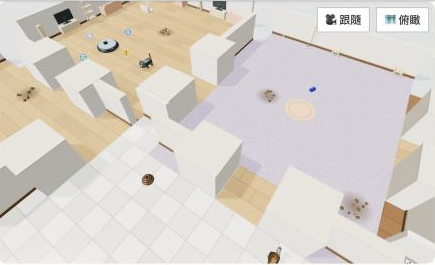
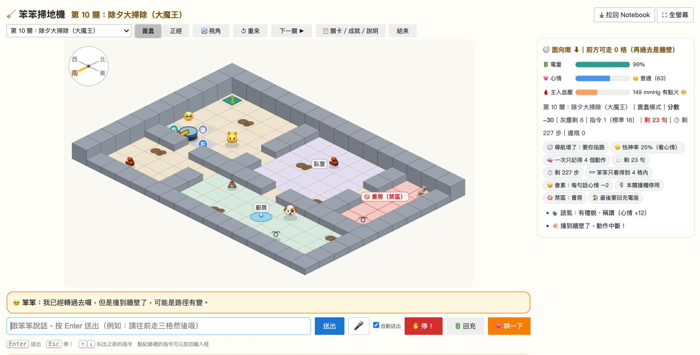

# 🤖 笨笨掃地機

以 LLM 為大腦、會「賣蠢」的 3D 掃地機器人指令遊戲（代理型人工智慧基礎與應用實作｜期末專題）。

玩家**只能用中文打字**指揮掃地機器人「笨笨」。笨笨的大腦是課程提供的 LLM，只能從固定動作選單挑選並回 JSON；
程式驗證白名單後交給遊戲引擎執行，碰撞、闖禁區等事件再回饋給 LLM，形成完整的 Agent 閉環。

**v2 玩法**（靈感：《教妹妹開車》——只能動口、對方不一定照做、語氣太兇會鬧脾氣）：
💗 笨笨的心情會被你的語氣影響（罵它會頂嘴、罷工）｜🩸 出包會讓主人血壓飆高，爆表就失敗｜🔋 電量｜
🎲 寵物亂跑、打翻果汁、狗便便、門鈴等突發事件｜⭐ 連擊、三星評價｜🏅 成就｜🔓 關卡解鎖＋每日挑戰地圖。

**v3**（依試玩回饋）：🧗 **教學關＋10 個難度遞增的關卡**——笨笨會**恍神**不照做（左右不分、煞車失靈、忘記吸……機率跟心情連動）、
記性差、導航壞掉要你指路、停電只看得到附近、步數限制｜🧭 清楚的**方向標示**（黃箭頭、前方 1 2 3 格、左／右、指北針、俯視視角）｜
🪟 **遊戲視窗**：可以**彈出成獨立視窗**或全螢幕，Enter 送出、Esc 停｜📜 對話框下方的**指令紀錄**｜🎤 [語音輸入評估](docs/voice_input.md)。

**v5**：🧊 **3D 視角**（Three.js）：有家具的房子（沙發、電視、廚房、書櫃、浴室；木地板／磁磚／地毯）、會走路的貓和柴犬、細節完整的掃地機器人、陰影與燈光；相機跟在笨笨背後（畫面的左右＝笨笨的左右），也可以俯瞰。模型都是 CC0（Kenney、Quaternius，見 `bendan/assets/3d/LICENSE.md`）。



**v6**：🚗 **連續移動，像開車一樣**——說「往前」笨笨就一直往前開，喊「停」（或按 Esc／✋ 停！）才停；開的時候說「左轉」「右轉」會轉完繼續開。
有講距離（「往前走三格」）才走固定格數。新增 🌀 **吸塵模式**：「開吸塵」之後走過的地方都會順便吸（但碰到襪子、水漬一樣出事，記得「關吸塵」）。
🗺️ **地圖放大**：每格切成 2×2，地板面積約 4 倍，灰塵數量加倍（放大規則與難度參數換算見 `bendan/world/scale.py`）；畫面上笨笨用等速補間滑行，不再一格一格跳。

**v7**：🎞️ **肉眼看起來連續的移動**——遊戲邏輯還是格子（房間、灰塵、碰撞、LLM 的描述都用格子算），但笨笨改由瀏覽器自己畫：
每移動一格（或轉 90 度）切成 **30 幀**播放（預設每格 0.5 秒 ≈ 60 fps），效果等於把地圖放大 30 倍、笨笨每幀走 1/30 格；2D 和 3D 共用同一套動畫。
地板上的 1 2 3… 編號和「左／右／後」標示拿掉了，看笨笨身上的黃色箭頭就知道朝向。
🔊 **笨笨會說話**：用瀏覽器內建的語音合成唸出笨笨的回答（Mac 用「美佳」台灣中文語音，不用另外安裝），音高、語速跟著情緒變；畫面上的 🔊 可以關掉，按住 🎤 講話時笨笨會先閉嘴。

**v8**：💥 **會壞掉的笨笨**——撞到牆、家具、寵物，或吸到不該吸的（襪子、水、樂高、電線、便便）就會受損：
第一次**冒煙**（一直冒煙、噴火花、LED 眼睛變成暈眩的漩渦），第二次**整台爆炸**（火球、衝擊波、零件四散、地板燒焦，這關失敗）。
🧱 **真的撞到牆**：牆壁改成實心、牆面就在格子邊界上，家具也改成地圖上真的障礙物（沿牆擺放，LLM 看得到「前方第 3 格是沙發」）；
撞到時笨笨會往前貼上牆面／家具，再微微彈回，不會停在半空中。
🏠 **更像真的家**：牆加高到 2.4、加上天花板（吸頂燈、客廳吊扇）、窗戶與窗簾、掛畫、門楣、踢腳板與線板、廚房和浴室的磁磚牆、書房的木頭護牆板、牆角陰影；
俯瞰時牆會自動「剖面」降低、天花板變透明（像模擬市民）。相機：🎥 跟隨（碰到牆會自動拉近，不穿牆）／👀 笨笨視角／🗺️ 俯瞰／📹 監視器（房間角落的監視器畫面）。
🎲 **新事件**：🕳️ 地洞（掉下去會摔壞，主人把它撈回充電座）、🌏 地震（被晃得轉向、東西掉滿地、地板可能裂開）、🪳 小強（會亂跑，吸到有獎勵）、
🍌 香蕉皮（踩到轉好幾圈）、🐱 貓咪搭便車、🧰 維修包（冒煙時出現，撿到修好一次）。
🔈 **音效**：撞擊、冒煙、爆炸、掉洞、維修、吸塵馬達聲……全部用 WebAudio 即時合成（跟 🔊 一起開關）。
🗑️ 2.5D 等角視角（SVG 與 matplotlib 版）全部移除，遊戲視窗只剩 3D；俯視 SVG 只留給文字模式與說明圖。

**v4**：🎤 **Whisper 語音輸入**——在自己電腦上跑時，按住 🎤 講話、放開就送出（聲音不離開電腦；用吼的會被判成「大吼」）。見 [docs/voice_input.md](docs/voice_input.md)。

詳見 [docs/gameplay.md](docs/gameplay.md)、難度曲線實測 [docs/difficulty.md](docs/difficulty.md)。



## 專案結構

```
笨笨掃地機/
├── bendan/                    # 主程式套件
│   ├── config.py              #   路徑與設定（logs/、saves/）
│   ├── llm/                   #   LLM 連線層
│   │   ├── client.py          #     課程 OpenAI-compatible API、選模型、延遲測試
│   │   └── fake.py            #     離線 FakeLLM（沒有 API 也能測）
│   ├── world/                 #   遊戲世界（完全不依賴 LLM）
│   │   ├── constants.py       #     方向、地圖字元、障礙物、動作白名單
│   │   ├── levels.py          #     教學關＋10 個難度遞增的關卡＋評估場景
│   │   ├── scale.py           #     地圖放大 2 倍、灰塵加倍（v6）
│   │   ├── furnish.py         #     沿牆擺家具（真的障礙物）、挖地洞（v8）
│   │   ├── mapgen.py          #     今日挑戰：隨機地圖產生器（BFS 驗證可解）
│   │   └── game.py            #     引擎：移動、碰撞、受損（冒煙→爆炸）、電量、障礙物、BFS 回充、步數上限、停電
│   ├── agent/                 #   大腦
│   │   ├── prompts.py         #     動作規格、人設、心情／拒絕指示
│   │   ├── perception.py      #     以機器人為中心的世界描述
│   │   ├── memory.py          #     禁區、已清掃、最近指令
│   │   ├── parsing.py         #     JSON 解析＋白名單驗證
│   │   ├── guardrail.py       #     程式護欄：執行前模擬，攔下闖禁區的計畫
│   │   └── agent.py           #     組 Prompt → LLM → 驗證 → 重試 → 發呆
│   ├── gameplay/              #   玩法系統
│   │   ├── mood.py            #     語氣分析、笨笨的心情
│   │   ├── pressure.py        #     主人血壓計
│   │   ├── scoring.py         #     分數、連擊、星級
│   │   ├── incidents.py       #     突發事件導演
│   │   ├── quirks.py          #     恍神（不照做）與記性差
│   │   ├── achievements.py    #     成就（20 個）
│   │   └── progress.py        #     存檔、關卡解鎖
│   ├── session.py             #   Agent 迴圈＋玩法＋非同步＋事件回饋＋JSONL log
│   ├── render/                #   3D 世界狀態（給 Three.js）、俯視 SVG、HUD（HTML）、ASCII
│   ├── ui/                    #   遊戲視窗 play_widgets()（3D，scene3d.js；可彈出）、文字模式 play()、斜線指令
│   ├── voice/                 #   語音輸入：WAV 解碼與音量、Whisper 後端（mlx／faster-whisper／API）、辨識結果清理
│   └── evaluation/            #   照做率、格式正確率、記憶遵守率、心情實驗、log 分析
├── notebooks/
│   ├── 01_快速開始_遊玩.ipynb   # 連線 → 玩法說明 → 開始玩
│   ├── 02_Agent_原理展示.ipynb # 一步步拆解 Agent 閉環與玩法系統
│   ├── 03_評估.ipynb           # 評估指標＋心情 vs 照做率實驗
│   └── archive/               # v1 單檔版 Notebook（保留參考）
├── tests/                     # pytest（全部離線，不需要 API）
├── scripts/
│   ├── play_cli.py            # 終端機版（純文字地圖）
│   ├── difficulty_probe.py    # 難度曲線實測（腳本玩家跑每一關）
│   ├── build_notebooks.py     # 重新產生 notebooks/
│   └── pack_for_jupyterhub.py # 打包成 zip 上傳 JupyterHub
├── docs/
│   ├── gameplay.md            # 玩法設計文件
│   ├── architecture.md        # 系統架構
│   ├── evaluation_results.md  # 課程 JupyterHub × Qwen2.5-7B 實測結果
│   ├── difficulty.md          # 難度設計與實測
│   ├── voice_input.md         # 語音輸入可行性評估
│   └── proposal/              # 期末專題提案
└── requirements.txt
```

## 使用方式

### 在課程 JupyterHub
1. 在自己電腦執行 `python scripts/pack_for_jupyterhub.py`，得到 `dist/bendan_jupyterhub.zip`。
2. 上傳 zip 到 JupyterHub，在 Terminal 執行
   `python3 -c "import zipfile; zipfile.ZipFile('bendan_jupyterhub.zip').extractall('笨笨掃地機')"`。
3. 打開 `笨笨掃地機/notebooks/01_快速開始_遊玩.ipynb`，**Kernel 選「Python 3 (ipykernel)」**，由上往下執行。
4. 第 3 節的遊戲視窗出現後，按右上角「🪟 彈出成獨立視窗」就能在獨立視窗裡玩（被擋的話允許彈出式視窗）。

> ⚠️ 實測：「Python (Lab 1)」Kernel 只有 openai，沒有 ipywidgets／pandas（只能玩文字模式、不能跑評估）；
> 「Python 3 (ipykernel)」全部都有，API 設定也讀得到。第一格的 `bendan.check_env()` 會列出缺什麼。

實測結果（Qwen2.5-7B 的照做率、禁區遵守率、心情實驗、遊玩紀錄）見 [docs/evaluation_results.md](docs/evaluation_results.md)。

### 在自己電腦（可以用語音）
```bash
pip install -r requirements.txt -r requirements-voice.txt   # 語音輸入（Whisper）可選
export OPENAI_BASE_URL=http://127.0.0.1:<埠>/v1 OPENAI_API_KEY=<key>   # 自己的 LLM；沒設就用離線 FakeLLM
jupyter lab notebooks/01_快速開始_遊玩.ipynb   # 沒有 API 設定時自動用離線 FakeLLM
python scripts/play_cli.py                     # 或直接在終端機玩（預設從還沒破的第一關開始）
pytest -q                                      # 跑測試
```

### 在程式裡用
```python
from bendan import llm, play, play_widgets
llm.connect()                  # 連線課程 API（或 FakeLLM）
play_widgets()                 # 遊戲視窗（推薦）；從還沒破的第一關開始
play_widgets(level=9, unlock_all=True)   # 直接玩停電關
play()                         # 文字模式；/help 看指令
```

請勿將 API Key 提交到 repo。`logs/`、`saves/`、`dist/` 已在 `.gitignore`。
